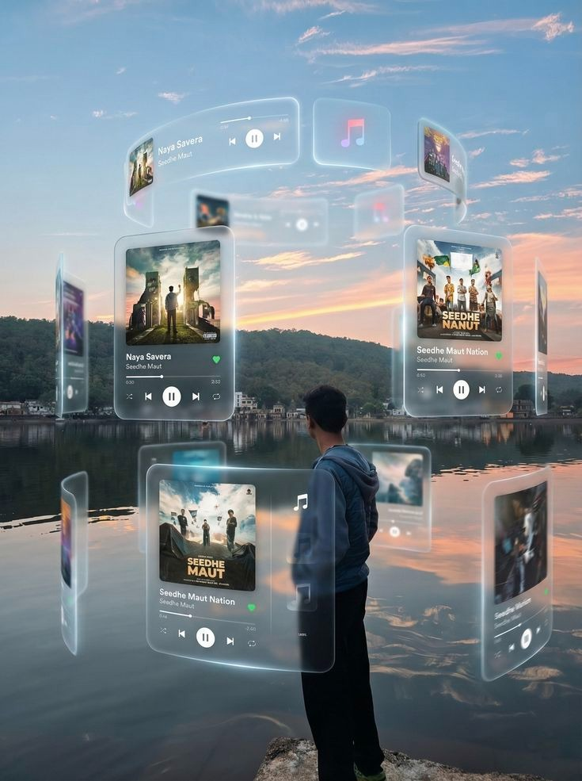

# Parth S Jalan — Creative Software Developer & Full Stack Engineer

A modern, high-performance portfolio featuring interactive 3D elements, smooth scroll choreography, luxury editorial aesthetics, and an architectural showcase of engineering craftsmanship.



---

## ⚡ Tech Stack & Architecture

- **Core Framework**: React 19, Vite 6
- **Styling & Design System**: Tailwind CSS, PostCSS, Custom Warm Editorial (`#faf8f5`) Palette
- **Animation & Motion**: Framer Motion, GSAP, Custom Canvas Particle Engine
- **3D Graphics**: Three.js, WebGL Interactive Spatial Elements
- **Icons & Visuals**: Lucide React, Custom SVG Icons
- **Interactive FX**: Canvas Confetti

---

## 🚀 Key Features

1. **Spatial 3D & Cursor Parallax Hero**: Smooth mouse-reactive lighting and floating glass badges.
2. **Dynamic Continuous Marquee**: Silky infinite brand ribbon.
3. **Editorial About Section**: Frosted glass card with custom front-facing avatar display and responsive layout.
4. **Experience Flow**: Curated journey through software engineering roles and production impact.
5. **3D Project Carousel**: Interactive 3D perspective showcasing featured applications.
6. **Technical Ecosystem**: Architectural bento grid detailing core competencies.
7. **Line-by-Line Staggered Contact Lounge**: Sequential scroll-reveal contact form with 1-click clipboard copy and celebratory submission feedback.

---

## 🛠️ Local Development

### Prerequisites
- Node.js 18+
- npm or yarn

### Installation
```bash
# Clone the repository
git clone https://github.com/ParthJalan19/parth-portfolio.git

# Navigate to project directory
cd parth-portfolio

# Install dependencies
npm install

# Start local development server
npm run dev
```

### Production Build
```bash
npm run build
npm run preview
```

---

## 📬 Contact & Socials

- **Portfolio**: [Parth Jalan Portfolio](https://github.com/ParthJalan19/parth-portfolio)
- **LinkedIn**: [Parth Jalan](https://linkedin.com/in/parth-jalan-773870sm)
- **GitHub**: [@ParthJalan19](https://github.com/ParthJalan19)
- **Email**: parthjalan19@gmail.com
